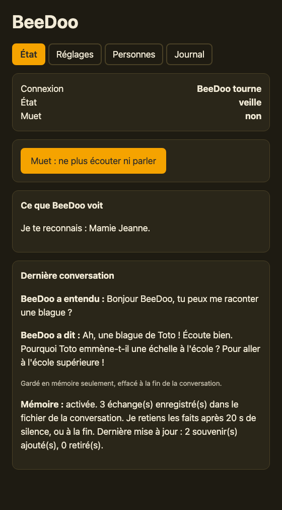
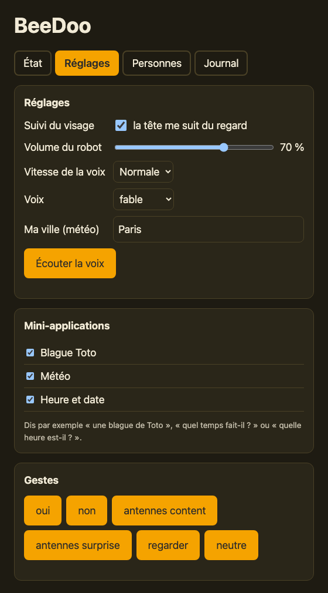
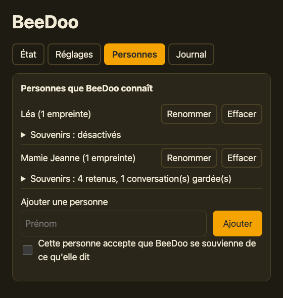
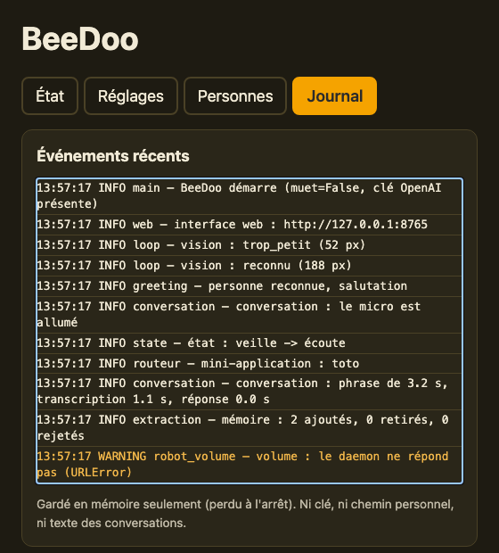

# BeeDoo

BeeDoo est un robot d'accompagnement basé sur un [Reachy Mini](https://github.com/pollen-robotics/reachy_mini) (Pollen Robotics). Il parle français comme un enfant de 7 ans, reconnaît les visages et dit bonjour par le prénom, discute, propose des mini-applications (blague Toto, météo, heure et date…) et, si la personne l'accepte, se souvient de ce qu'elle lui dit.

> **État du projet : en construction.** Le robot reconnaît et salue, discute, suit le visage, a des mini-applications, une mémoire facultative et une interface web. Il reste des mini-applications à écrire et des réglages à affiner.

## Aperçu

L'interface web (ici avec des personnes et des conversations **fictives**, générées par `scripts/demo_interface.py`) :

| État | Réglages |
|---|---|
|  |  |

| Personnes | Journal |
|---|---|
|  |  |

Pour voir l'interface sans robot ni clé : `python scripts/demo_interface.py`, puis ouvrir `http://127.0.0.1:8799`. Pour refaire les captures : `scripts/faire_captures.sh` (Google Chrome requis).

## Ce qu'il faut

- Un Reachy Mini (Lite, branché en USB, ou Wireless), ou le mode simulation du SDK pour essayer sans robot.
- Python 3.12 et git.
- Pour la conversation : une clé API OpenAI (LLM, reconnaissance vocale et synthèse vocale).

## Installation

```bash
# 1. Récupérer le dépôt avec le SDK (sous-module git)
git clone --recurse-submodules https://github.com/ticoraph/BeeDoo.git
cd BeeDoo

# 2. Créer l'environnement Python et installer BeeDoo (avec les outils de développement)
python3 -m venv .venv
source .venv/bin/activate
pip install -r requirements.txt

# 3. Activer les garde-fous contre les fuites de secrets (si tu contribues)
pre-commit install

# 4. Préparer la configuration (à compléter quand l'application utilisera les clés)
cp .env.example .env
```

Si tu as cloné sans `--recurse-submodules` : `git submodule update --init`.

Vérifier que tout est en place : `pytest`.

**Reconnaissance de visage** : elle se fait sur ta machine avec DeepFace (installé par `requirements.txt`, avec OpenCV `headless`). N'installe pas `opencv-python` à côté : deux paquets OpenCV se cassent mutuellement. Au premier usage, les modèles (environ 100 Mo) sont téléchargés depuis GitHub dans `~/.deepface/` : il faut donc un accès à GitHub une fois.

### Installer sur un autre Mac

Même procédure sur chaque Mac : on clone le dépôt et on lance le script d'installation.

```bash
brew install python@3.12 git        # si Python 3.12 et git ne sont pas déjà là
git clone --recurse-submodules https://github.com/ticoraph/BeeDoo.git
cd BeeDoo
scripts/install.sh
```

Le script crée le venv, installe les dépendances, crée `.env` et lance les tests. Il reste à faire à la main :

1. Renseigner `OPENAI_API_KEY` dans `.env` (la clé n'est jamais dans git, il faut la saisir sur chaque Mac).
2. Brancher le robot, puis lancer `scripts/lancer.command` (double-clic possible dans le Finder). Il démarre le daemon s'il ne tourne pas déjà, puis BeeDoo.
3. Autoriser l'accès à la **caméra** et au **micro** quand macOS le demande pour le Terminal.
4. Laisser DeepFace télécharger ses modèles au premier usage (accès à GitHub nécessaire).
5. Si le Mac a l'application « Reachy Mini Control », sa version du daemon peut différer de celle du SDK que `pip` vient d'installer (la dernière). `lancer.command` compare les deux et propose d'aligner le SDK (voir « Version du SDK » plus bas).

Les visages et les souvenirs vivent dans `data/`, qui n'est pas dans git : sur le nouveau Mac, **ajoute les personnes à nouveau** dans l'onglet « Personnes ». Si tu préfères copier `data/` toi-même, fais-le à la main (`scp`, clé USB), jamais par git, et sur tes propres machines seulement.

## Essayer le robot

Dans un premier terminal, lancer le daemon du robot (ou `reachy-mini-daemon --sim` pour la simulation) :

```bash
source .venv/bin/activate
reachy-mini-daemon
```

Dans un second terminal :

```bash
source .venv/bin/activate
python examples/test_connection.py
```

Le robot doit bouger la tête et les antennes pendant quelques secondes. Si l'application officielle « Reachy Mini Control » est ouverte, ferme-la : elle utilise le même port que le daemon.

### Sans robot : la simulation

Pour développer sans robot, installe l'option de simulation (MuJoCo), puis lance le daemon en mode `--sim` à la place du daemon habituel :

```bash
source .venv/bin/activate
pip install -e ".[sim]"
mjpython -m reachy_mini.daemon.app.main --sim    # macOS
reachy-mini-daemon --sim                         # Linux et Windows
```

BeeDoo se connecte ensuite exactement comme avec le vrai robot (`python -m beedoo.main`). Ne lance jamais deux daemons en même temps (même port 8000). En simulation, la carte audio du robot est absente : BeeDoo utilise le micro et les haut-parleurs de l'ordinateur, avec une annulation d'écho logicielle (moins fiable que celle du robot). L'écoute se règle donc au final avec le vrai robot.

### Version du SDK

Le SDK (`reachy-mini`, installé dans le venv) et le daemon doivent toujours avoir **la même version**. Si tu utilises l'application officielle « Reachy Mini Control », son daemon se met à jour avant le SDK : après une mise à jour, aligne le SDK.

Un écart déclenche, à la connexion, un avertissement qui donne les deux versions :

```
Reachy Mini SDK and daemon versions do not match: SDK=1.10.0, daemon=1.11.0
```

Dans ce cas, installe la version du daemon, puis relance `pytest` :

```bash
pip install "reachy-mini==1.11.0"
```

## Interface web

Quand BeeDoo tourne, une page locale permet de le surveiller et de le régler :

```
http://127.0.0.1:8765
```

Elle a quatre onglets :

- **État** : BeeDoo tourne-t-il, que voit-il (« je te reconnais », « tu es trop loin, approche-toi »), la dernière phrase entendue et dite, l'état de la mémoire, et le bouton **muet** (coupe l'écoute et la parole).
- **Réglages** : volume du robot, vitesse et choix de la voix, suivi du visage (la tête suit la personne du regard), ta ville pour la météo, activer ou désactiver chaque mini-application, essai de chaque geste.
- **Personnes** : ajouter (façon photomaton : BeeDoo dit à voix haute quelle pose prendre — face, tête à gauche, à droite, en haut, en bas, sourire — et fait « Clic ! » à chaque image ; la page affiche la même consigne), renommer, effacer (efface tout ce que BeeDoo sait de la personne), et les **souvenirs** de chacune.
- **Journal** : les événements récents (une personne reconnue, une mini-application lancée, une erreur…), sans clé, sans chemin personnel et sans le texte des conversations. Gardé en mémoire seulement, perdu à l'arrêt.

À savoir :

- Par défaut elle n'écoute que sur ta machine (`127.0.0.1`) et ne charge rien depuis Internet. Une requête venue d'un autre site ouvert dans ton navigateur est refusée.
- Le port se change avec `BEEDOO_WEB_PORT` dans `.env`. Si le port est déjà pris, BeeDoo démarre quand même, sans la page.
- Elle n'affiche et ne demande aucune clé API : elles restent dans `.env`.
- Mini-applications : « une blague de Toto », « quel temps fait-il ? » (aujourd'hui ou demain), « quelle heure est-il ? ». Pour la météo, écris le nom de ta ville dans les réglages : il est envoyé au service Open-Meteo (gratuit, sans clé).
- Souvenirs : par défaut BeeDoo ne retient rien. Si tu coches « accepte que BeeDoo se souvienne » pour une personne, il écrit ses conversations au fur et à mesure et en retient des faits (« sa fille s'appelle Anna ») après un moment de silence. Tu peux les relire, les corriger ou les effacer dans la page. Effacer une personne supprime aussi tous ses souvenirs.
- Les réglages sont enregistrés dans `data/settings.json` (ignoré par git).

### Ouvrir la page aux autres appareils du réseau (facultatif)

Par défaut, seul l'ordinateur de BeeDoo accède à la page. Pour la consulter depuis une tablette ou un téléphone de la maison, ajoute dans `.env` :

```
BEEDOO_WEB_HOST=0.0.0.0
BEEDOO_WEB_PASSWORD=choisis-un-mot-de-passe-long
```

Relance BeeDoo, puis ouvre `http://<adresse de l'ordinateur>:8765`. Le navigateur demande un mot de passe (l'identifiant est libre, par exemple `beedoo`).

- Sans mot de passe d'au moins 8 caractères, BeeDoo **refuse** d'ouvrir l'accès et reste limité à l'ordinateur (il le dit dans le terminal).
- Après 5 mots de passe faux de suite, l'adresse est bloquée une minute.
- **La connexion n'est pas chiffrée (http)** : le mot de passe et le contenu de la page (prénoms, souvenirs) circulent en clair sur le réseau. À n'utiliser que sur un réseau domestique de confiance, jamais sur un Wi-Fi public, et jamais exposé à Internet.
- Cette ouverture ne se règle que dans `.env`, pas depuis la page.

## Vie privée

BeeDoo manipule des données sensibles : visages, voix, conversations.

- Tout ce qui concerne les personnes est stocké **localement**, dans le dossier `data/`, qui n'est jamais versionné. Ses dossiers et fichiers ne sont accessibles qu'à ton compte (droits 700 et 600), resserrés à chaque démarrage de BeeDoo.
- Les clés API sont dans `.env`, qui n'est jamais versionné.
- La reconnaissance de visage tourne en local. Les images de la caméra ne sont jamais enregistrées ni envoyées : seules des empreintes numériques sont gardées dans `data/`. BeeDoo n'écoute que lorsqu'il voit une personne connue (et jamais en mode muet) : sans cela, le micro n'est pas lu. En revanche, le texte et l'audio des conversations sont envoyés à OpenAI, ainsi que le texte des salutations, qui contient le prénom de la personne reconnue. La météo envoie le nom de ta ville à Open-Meteo. Si la mémoire est activée pour une personne, ses conversations sont aussi envoyées à OpenAI à la fin pour en retenir des faits, et sont gardées en texte dans `data/personnes/` (jamais versionné). Informe les personnes concernées et respecte leur choix.
- Si tu contribues (merci !), lis [`CONTRIBUTING.md`](CONTRIBUTING.md). Pour signaler une faille ou une fuite de données : [`SECURITY.md`](SECURITY.md). Ne pousse jamais de clé, de photo, d'enregistrement, de vraie conversation, de prénom de vraie personne ni de chemin personnel. Les exemples et les tests n'utilisent que des personnes fictives. Les garde-fous `pre-commit` vérifient une partie de ces règles.

## Organisation du dépôt

| Dossier | Contenu |
|---|---|
| `prompts/` | Personnalité de BeeDoo (prompt du LLM) |
| `src/beedoo/` | Code de l'application (gestes, vision, voix, LLM, mémoire, mini-apps, interface) |
| `tests/` | Tests |
| `scripts/` | Petits outils (photo, enregistrement audio, interface de démonstration, captures) |
| `captures/` | Captures d'écran de l'interface de démonstration (personnes fictives) |
| `examples/` | Essais de connexion au robot |
| `reachy_mini/` | SDK officiel (sous-module git, lecture seule) |

## Licence

Copyright 2026 BeeDoo contributors.

BeeDoo est distribué sous licence [Apache 2.0](LICENSE). Le SDK `reachy_mini` (sous-module) a sa propre licence, également Apache 2.0.
